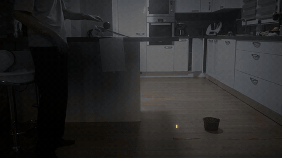
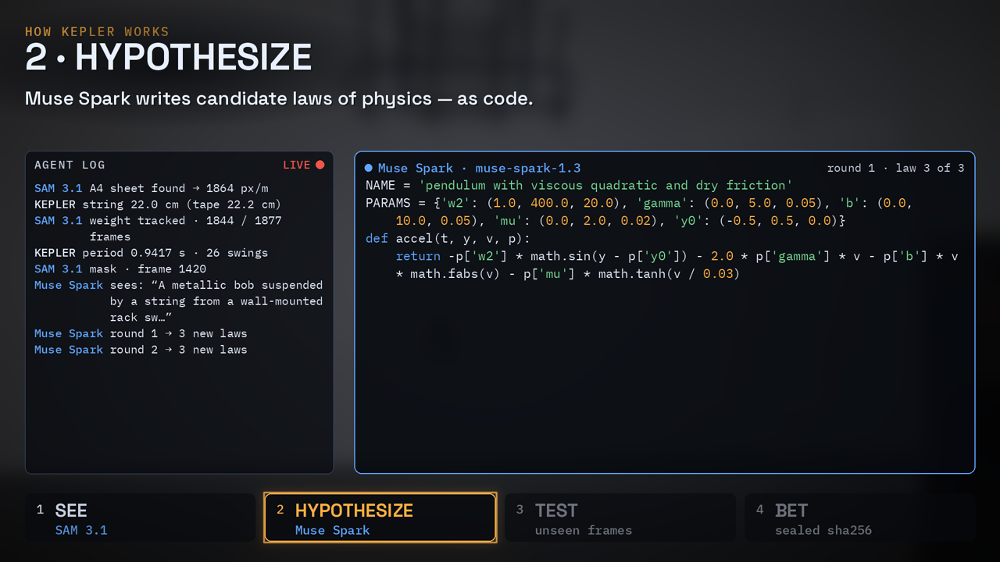
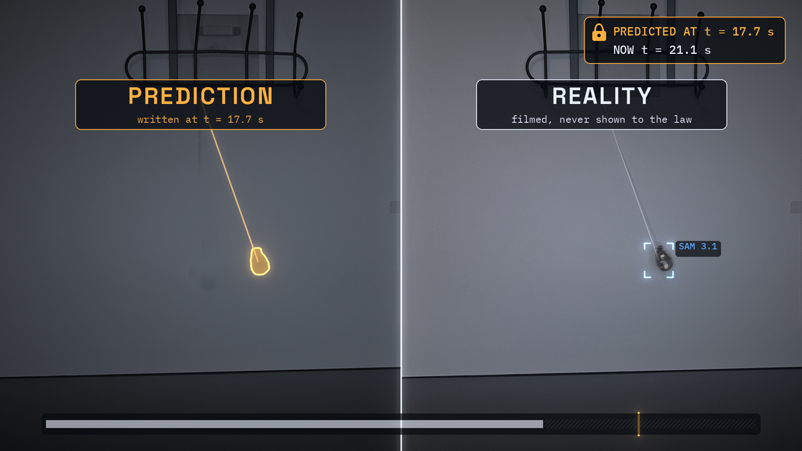
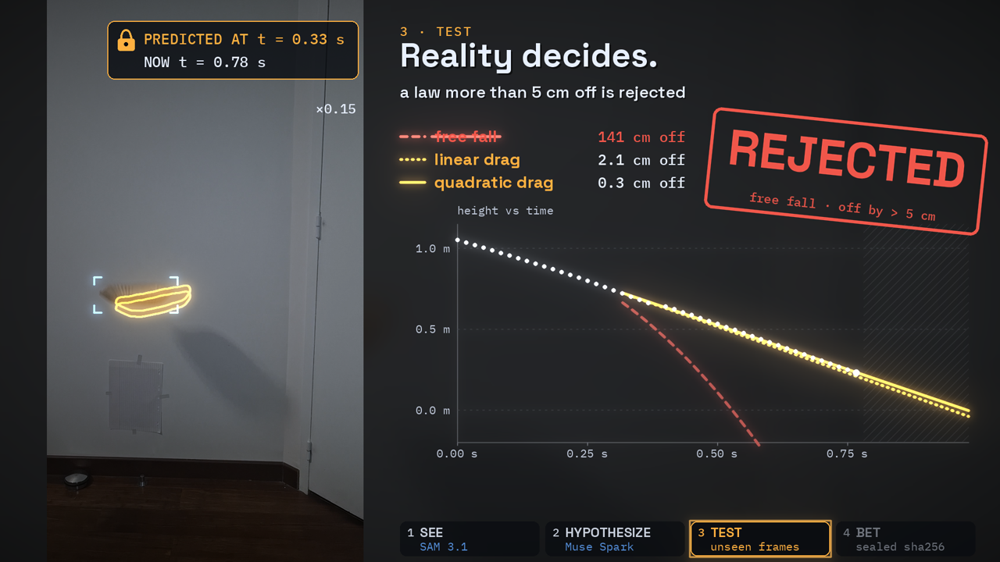

# Kepler: an AI scientist that doesn't guess

Film an experiment with your phone. Kepler watches it (SAM 3.1), writes its own laws of physics as code (Muse Spark), tests them on frames it never saw, and bets on the future.



*39.8 cm, sealed at 19:12:29. The ball was thrown at 19:19:56. It landed in the basket.*

Demo video: <YOUTUBE_LINK>

This is a proof of concept built in a few days for the Meta Global AI Developer Hackathon (Indie track).

## How it works

1. **SEE.** SAM 3.1 finds the moving object and tracks it frame by frame. An A4 sheet (or gravity itself) turns pixels into meters. Time comes from each frame's own timestamp, not from an assumed fps.
2. **HYPOTHESIZE.** Muse Spark looks at a few frames, describes the setup and writes candidate laws as small Python functions (`accel(t, y, v, p)` plus parameter bounds). They compete with a built-in library of classic laws.
3. **TEST.** Each law is fitted on the first part of the motion only and judged on the rest, which it never saw. Laws run in a sandbox. A law that drifts too far is rejected.
4. **BET.** The winning law predicts what comes next. The prediction is hashed (sha256) and timestamped *before* reality is compared to it.



## Results (real clips, filmed at home)

| Check | Kepler | Reference | Gap |
|---|---|---|---|
| Pendulum length, from the A4 sheet | 22.0 cm | 22.2 cm (tape) | −0.9 % |
| Pendulum, 7.6 s it never saw | predicted path | SAM 3.1 track | 3.5 mm mean, 7.3 mm max |
| Cup landing spot, sealed before the throw | 39.8 cm | basket placed at 39.8 cm | ball in the basket |
| Cup, two practice rolls | 40.2 / 39.3 cm | each other | 0.9 cm |
| Short-string bet | 0.610 s | 0.6295 s (measured) | +3.2 % (released at 57°, not 30°) |

**Pendulum.** 12 laws competed: 6 from the library, 6 written by Muse Spark over 2 rounds. The winner was Muse Spark's *pendulum with viscous quadratic and dry friction*, at 1.20 % error on unseen data. The best built-in law (*damped pendulum, linear*) scored 1.48 %. Kepler predicted 7.6 s of motion it never saw. The predicted bob stayed 3.5 mm from the real one on average, 7.3 mm at worst.



**Falling paper.** Free fall was rejected: 265 cm off on the unseen part, against a 5 cm threshold. Air drag was kept (quadratic drag: 0.9 cm off).



**The cup.** From two practice rolls off a table, Kepler announced where to put the cup: 39.8 cm. That number was sealed at 19:12:29 (sha256 `bccd98ce…df2246`). The throw was filmed at 19:19:56, and the ball landed in the basket.

**A bet it lost.** Kepler announced a period of 0.610 s for a shortened pendulum. The measured period was 0.6295 s (+3.2 %), because the pendulum was released at 57° instead of 30°. The large swing broke the small-angle assumption.

## Why Meta models

SAM 3.1 gives the trajectory, frame by frame. Muse Spark proposes laws as code, and that code runs in a sandbox. No number comes from an LLM's text. Every value is computed, fitted and checked against the video.

## Quickstart

Requires Python 3.12+, [uv](https://docs.astral.sh/uv/) and `ffmpeg`.

```bash
uv sync
export META_API_KEY=...
uv run kepler run clip.mp4 --experiment pendulum --prompt "pendulum bob"
```

`--experiment` and `--prompt` are optional: without them, Muse Spark describes the setup itself. The output folder (`clip_kepler/` by default) contains `report.json`, `seal.txt` and `kepler.mp4`, which shows the predicted motion as an overlay on the video.

Other commands:

- `kepler bet` predicts the period of a shortened pendulum.
- `kepler cup` predicts where a ball rolling off a table will land.
- `kepler weigh` estimates a mass from a bounce on an elastic.

`--tracker color --box X1,Y1,X2,Y2` replaces SAM 3.1 with a free color tracker. See `uv run kepler <command> --help`.

**Cost.** A 10-second clip at 60 fps costs about 0.20 USD. SAM 3.1 tracking costs 0.0002 USD per frame, and Muse Spark adds 0.05 to 0.20 USD. The whole project, every test run included, cost 3.51 USD. A spending tracker (`~/.kepler/budget.json`, `--cap`) stops paid calls once the cap is reached.

## Development

```bash
make check   # ruff, pyright, pytest (offline: fake clients and synthetic videos)
```

## Credits

Music in the demo video: "Stay the Course" Kevin MacLeod (incompetech.com)
Licensed under Creative Commons: By Attribution 4.0
https://creativecommons.org/licenses/by/4.0/

## License

[MIT](LICENSE) © 2026 Yanis Djeridi
